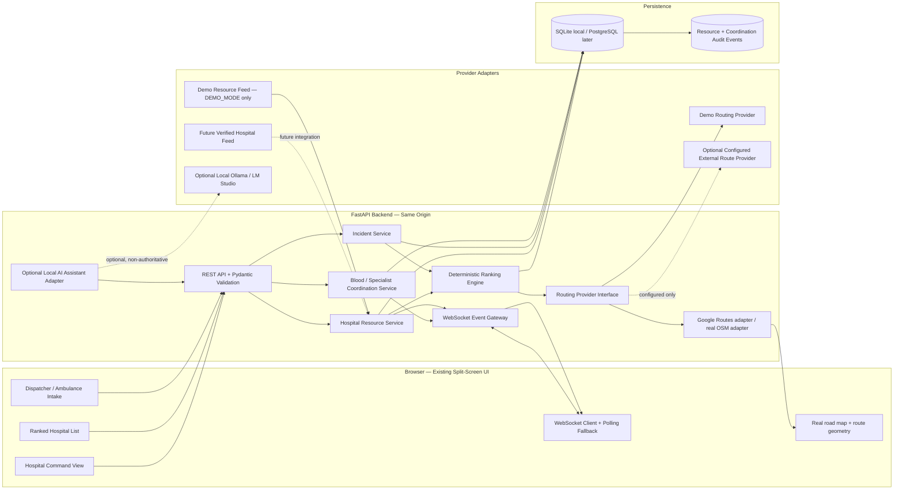
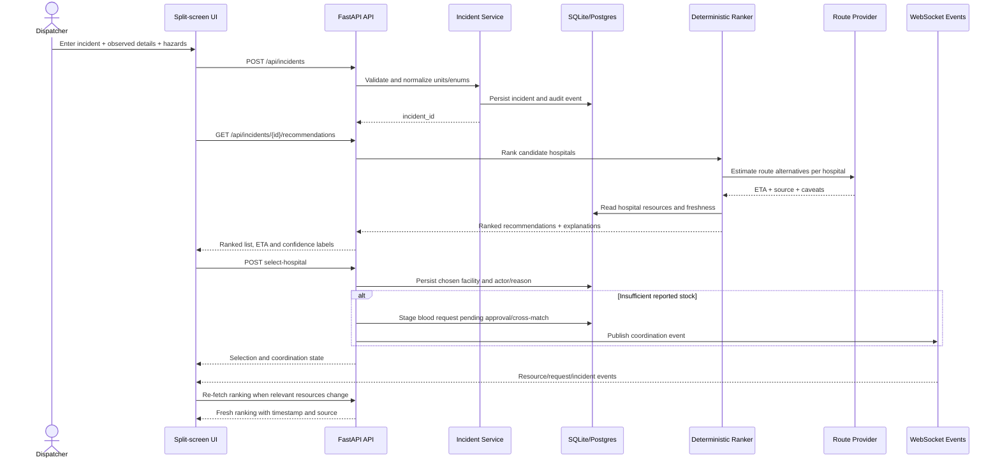

# Golden Hour Grid — Target Architecture

## 1. Architectural overview



## 2. Request lifecycle



## 3. Main modules and responsibilities

| Module | Responsibility | Must not do |
|---|---|---|
| API routes | HTTP/WebSocket transport, status codes, request limits | Implement ranking math in route handlers |
| Pydantic schemas | Validate inputs/outputs and units | Silently coerce bad values or undocumented units |
| Incident service | Create/update incident, version state, audit changes | Diagnose patient or infer treatment |
| Hospital repository/service | Read coherent current resource snapshot, expose source/time/freshness | Pretend a stale or unknown value is current |
| Ranking engine | Score eligible options deterministically, return reasons and component scores | Use an LLM, claim clinical outcome, use gender as a weight |
| Routing provider | Produce estimate + provider metadata + uncertainty | Label schematic/demo estimates as live navigation |
| Blood coordination | Create deduplicated, staged request and track status | Automatically send a real transfusion order or claim delivery |
| Specialist coordination | Track pre-alert and connection state honestly | Pretend a call/video connection exists |
| Realtime gateway | Broadcast typed resource/ranking/request events | Publish PHI or trust browser messages as authoritative |
| Demo feed | Mutate synthetic fixture data only when explicitly enabled | Run in production by default |
| Local AI adapter | Optional operational summary/checklist only | Rank hospitals, diagnose, predict survival, give treatment guidance |

## 4. Suggested project layout

```text
AGENTS.md
README.md
.env.example
.gitignore
pyproject.toml or requirements.txt
frontend/
  index.html
  styles.css
  app.js
backend/app/
  main.py
  core/config.py
  api/routes/{health,hospitals,incidents,resources,coordination,assistant}.py
  api/dependencies.py
  schemas/{incident,hospital,ranking,coordination,events}.py
  models/{hospital,incident,resource,coordination,audit}.py
  db/{session,base,migrations}/
  repositories/{hospital,incident,coordination}.py
  services/{incident,resource,coordination,ranking,route}.py
  ranking/{engine,weights,explanations}.py
  providers/routing/{base,demo,external}.py
  providers/resources/{base,demo_feed,external}.py
  providers/assistant/{base,ollama,openai_compatible}.py
  realtime/{manager,event_schemas}.py
scripts/seed_demo_data.py
 tests/{unit,integration,e2e}/
docs/{IMPLEMENTATION_PLAN,ARCHITECTURE,API_CONTRACT,DATA_DICTIONARY,SAFETY_AND_LIMITATIONS}.md
docs/legacy/golden_hour_grid_v2_live_demo.html
```

## 5. Data model relationships

- `Hospital 1 — many HospitalResourceSnapshot`
- `Hospital 1 — many SpecialistAvailability`
- `Hospital 1 — many BloodInventory rows` (one row per ABO/Rh group and timestamp/current state)
- `Incident 1 — many HospitalRecommendation` (versioned ranking run)
- `Incident 1 — many CoordinationRequest`
- `Incident/Hospital 1 — many AuditEvent`
- `ResourceEvent -> relevant hospital/resource field -> active ranking recomputation`

Every resource record needs `source`, `observed_at`, `received_at`, `is_demo`, and freshness status or enough fields to derive them. Use UTC internally. Do not represent unavailable source metadata as verified.

## 6. Ranking model (illustrative, configurable)

Start with a transparent weighted score for hospitals that are accepting and not verifiably unreachable:

- ETA: 25%
- Required specialty/capability: 25%
- ICU readiness: 20%
- ER load: 10%
- Blood-support readiness: 10%
- Data freshness: 10%

Return component scores and `reasons[]`, `warnings[]`, `source`, `computed_at` and `is_demo`. Weights are demonstrator assumptions, not clinically validated. Normalize each component to 0–100 and use a documented deterministic tie-breaker such as higher freshness, then lower ETA, then stable hospital ID. Avoid hidden special cases. A resource shortage is a coordination warning, not automatic exclusion, unless a future reviewed business rule explicitly establishes otherwise. Unknown values must be visible and penalized/uncertain, not treated as zero or “no issue”.

## 7. Proposed REST and event contract

### REST endpoints

| Method | Endpoint | Purpose |
|---|---|---|
| GET | `/api/health` | App, DB and demo-feed health |
| GET | `/api/hospitals` | List current hospital snapshot |
| GET | `/api/hospitals/{id}` | Detail and provenance |
| GET | `/api/resources/snapshot` | Coherent ICU/ER/specialist/blood snapshot |
| POST | `/api/incidents` | Validate and persist incident |
| GET | `/api/incidents/{id}` | Read incident and status |
| GET | `/api/incidents/{id}/recommendations` | Get latest deterministic ranking |
| POST | `/api/incidents/{id}/recompute` | Force a new route/ranking evaluation |
| POST | `/api/incidents/{id}/select-hospital` | Select or override destination, record reason |
| GET | `/api/incidents/{id}/coordination-requests` | Read blood/specialist request states |
| POST | `/api/incidents/{id}/blood-requests` | Stage request pending human/blood-bank review |
| POST | `/api/incidents/{id}/specialist-requests` | Stage specialist pre-alert |
| PATCH | `/api/incidents/{id}/status` | Validated incident state transition |
| POST | `/api/demo/resource-updates` | Test-only synthetic update, DEMO_MODE only |
| GET | `/api/assistant/health` | Optional local assistant availability |
| POST | `/api/assistant/coordination-note` | Non-authoritative local note from synthetic/demo data |
| WS | `/ws/updates` | Live resource, rank and coordination events |

### WebSocket event envelope

```json
{
  "event_id": "uuid",
  "event_type": "hospital.resource_changed",
  "occurred_at": "2026-10-13T12:00:00Z",
  "source": "demo_resource_feed",
  "is_demo": true,
  "entity_id": "demo-hospital-2",
  "payload": {
    "field": "icu_available",
    "previous": 3,
    "current": 2,
    "incident_ids_to_recompute": ["demo-incident-123"]
  }
}
```

Keep event schemas typed and versionable. For multiple simultaneous clients, use a manager abstraction; SQLite is appropriate for a local demo, not necessarily a multi-instance deployment.

## 8. Security, privacy and deployment boundary

Local hackathon mode: no real patient identifiers; no cloud AI calls; demo endpoints guarded by `DEMO_MODE`; `.env` ignored; minimal logs; local bind by default. Do not claim it is safe for actual dispatch. Before real use, the system needs institutional approval, privacy/security review, authenticated role-based access, audit policies, encrypted transport, authorized hospital/blood-bank agreements, clinician-reviewed workflows, validated resource feeds, service monitoring, tested failure handling, accessibility, and jurisdiction-specific legal/regulatory review.


## 8. Real map rendering and route providers

Follow `docs/REAL_MAP_AND_ROUTING.md`. Render actual detailed street geometry in roadmap mode; the old schematic SVG is only a legacy design artifact and must not appear in the operational interface. The default target is Google Maps JavaScript API with `roadmap` rendering and a backend Google Routes API adapter using traffic-aware route matrix results for candidate ETAs. Fetch full route geometry only for selected/expanded recommendations. Browser map key and backend routes key must be separate and restricted appropriately.

When provider configuration is absent or an API call fails, show a clear setup/offline state and do not display a fabricated route or ETA. Demo routing is allowed only behind explicit `DEMO_MODE=true` and must be marked as synthetic; it must not masquerade as a real route. Roadworks, rail crossings, floods, landslides, and roadblocks need real provider/operator evidence before they can be presented as verified active hazards.
